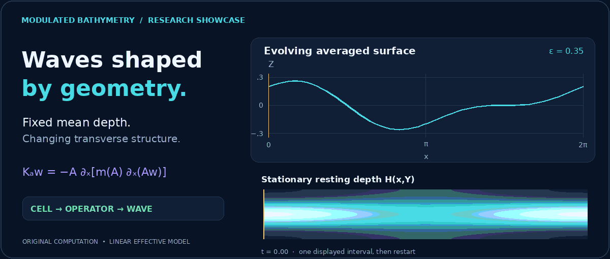
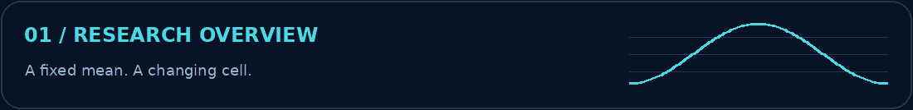
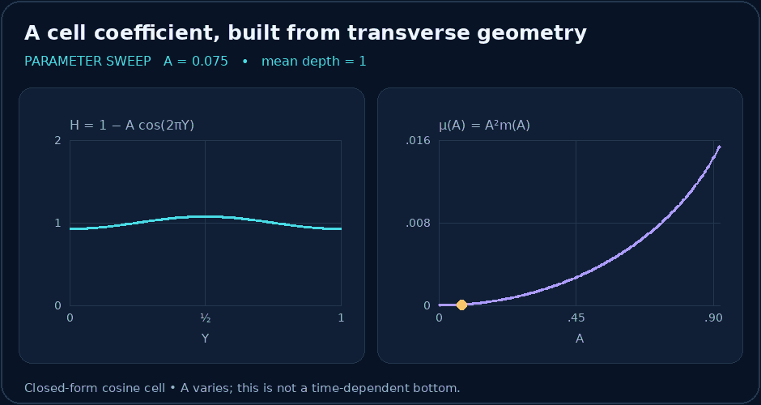
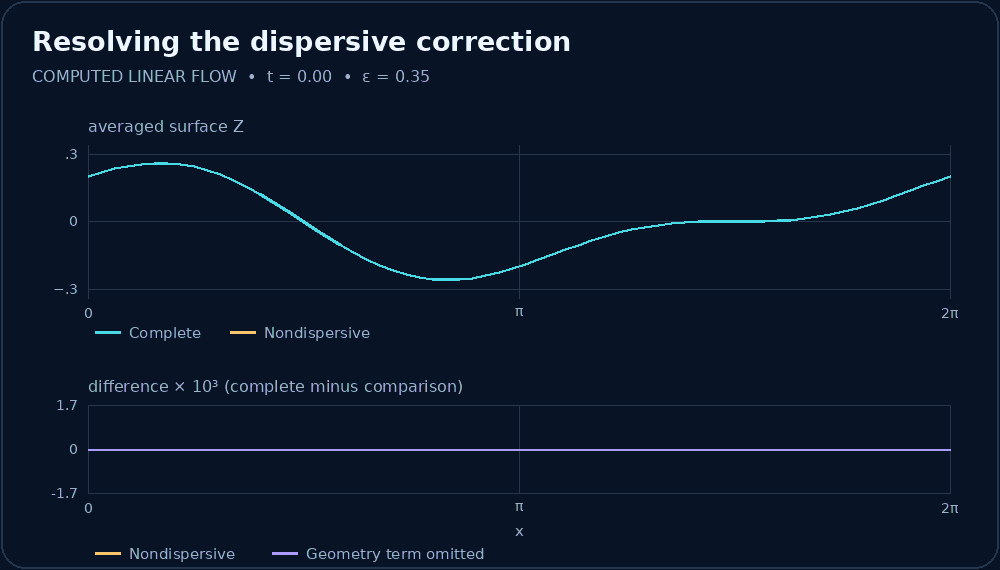
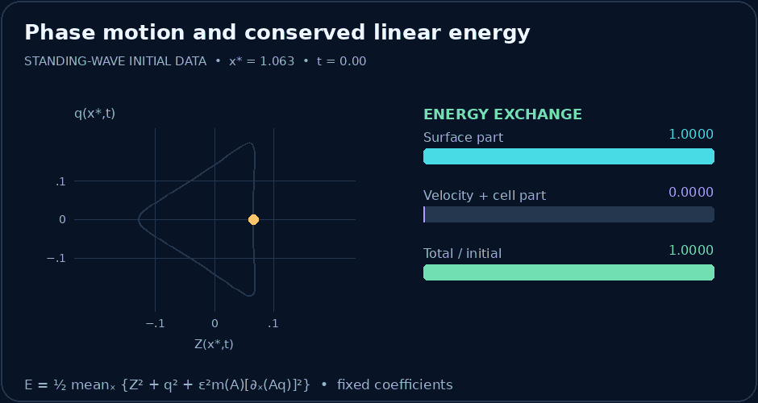
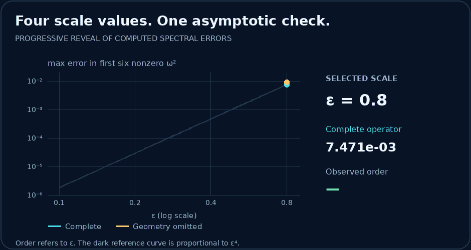

<div align="center">



# Modulated Bathymetry · Research Showcase

**Transverse geometry. Effective dispersion. Structure-preserving computation.**


<a href="#overview"></a>
<a href="#mathematics"></a>
<a href="#gallery"></a>
<a href="#verification"></a>

[Static reading mode](docs/static_gallery.md) · [Rebuild the figures](docs/reproducibility.md) · [Figure guide](docs/visualizations.md) · [Upload guide](docs/upload.md)

</div>

<a id="overview"></a>
## 📘 Research overview



How can a bottom with fixed mean depth change the propagation of long waves? Transverse variations in depth generate a dispersive correction. When their amplitude also varies along the propagation direction, that correction contains an additional geometric contribution.

This repository makes that mechanism visible through newly computed linear solutions, coefficient sweeps, phase traces, and spectral comparisons. The mathematical notes derive the cell coefficient and positive energy identity. Every distributed graphic and all project code were created for this showcase.

| Start with | Explore | What it establishes |
| :-- | :-- | :-- |
| **Geometry** | A periodic cell with variable amplitude | Mean depth can remain fixed while the effective coefficient changes |
| **Operator** | A factored spatial correction | The geometric term belongs to the positive quadratic form |
| **Dynamics** | Linear effective-wave evolution | Small dispersive differences accumulate over the displayed interval |
| **Verification** | Energy and low-frequency eigenvalues | Discrete conservation and observed fourth-order spectral agreement |

> **Scope.** The moving solutions are computations of the **linear effective model**. The spectral experiment compares it with a specified two-dimensional linear reference operator. These figures do not establish nonlinear homogenization, long-time approximation, or agreement with measured water-wave data.

<a id="mathematics"></a>
## 🧮 Mathematical framework


The resting depth and effective correction are

$$
H(x,Y)=1-A(x)\cos(2\pi Y),\qquad
\mathcal K_A w=-A\,\partial_x\!\left[m(A)\,\partial_x(Aw)\right],
$$

$$
m(A)=\frac{1}{4\pi^2\left(1+\sqrt{1-A^2}\right)},\qquad |A|<1.
$$

The displayed wave calculations solve

$$
Z_t+q_x=0,\qquad (I+\varepsilon^2\mathcal K_A)q_t+Z_x=0.
$$

<details>
<summary><strong>📐 Expand the cell calculation and geometric term</strong></summary>

For the zero-mean primitive $B(Y)=\sin(2\pi Y)/(2\pi)$, the cell coefficient is $m(A)=\langle B^2/H\rangle_Y$. With $\mu=A^2m$, direct differentiation gives

$$
\mathcal K_Aw=-\partial_x(\mu w_x)-A(mA')_xw.
$$

The second term vanishes for constant amplitude, but is generally present when $A=A(x)$. Keeping both terms gives

$$
\int w\mathcal K_Aw\,dx=\int m(A)\,[\partial_x(Aw)]^2\,dx\geq0.
$$

[Read the calculation, step by step →](docs/mathematical_overview.md)

</details>

<details>
<summary><strong>🔬 Expand the conserved energy</strong></summary>

With periodic boundary conditions and fixed coefficients,

$$
E(t)=\frac12\left\langle Z^2+q^2+\varepsilon^2m(A)[\partial_x(Aq)]^2\right\rangle_x,
\qquad \frac{dE}{dt}=0.
$$

The phase-space figure tracks values at a fixed spatial probe. It is not a particle trajectory. Its bars show exchange between the surface part and the combined velocity/cell part of this energy.

[Derivation and numerical interpretation →](docs/verification.md)

</details>


<a id="gallery"></a>
## 🎞️ Dynamic visualizations

**Four views of the same mechanism.** Open any figure for its full resolution. The wave and phase movies replay a finite interval; a restart is not a claim of exact temporal periodicity.

| Parameter-dependent geometry | Evolving solution comparison |
| :--: | :--: |
| [](assets/animations/cell-coefficient.gif) | [](assets/animations/wave-comparison.gif) |
| A prescribed sweep of $A$, with fixed mean cell depth. | Complete, nondispersive, and geometry-omitted effective flows. |
| **Phase motion and energy** | **Spectral convergence** |
| [](assets/animations/phase-energy.gif) | [](assets/animations/spectral-convergence.gif) |
| A fixed-location trace beside normalized energy components. | Four computed scale values, revealed in sequence. |

[Full captions and playback conventions](docs/visualizations.md) · [Static gallery](docs/static_gallery.md)


<a id="results"></a>
## 📊 Numerical results


For $A(x)=0.5+0.2\cos x$, the maximum absolute discrepancy in the first six nonzero squared frequencies is:

| ε | Complete operator error | Geometry-omitted error | Complete order |
| :-- | --: | --: | --: |
| 0.8 | 7.470792e-03 | 9.009337e-03 | n/a |
| 0.4 | 4.944655e-04 | 8.854587e-04 | 3.917 |
| 0.2 | 3.130217e-05 | 1.294608e-04 | 3.982 |
| 0.1 | 1.962488e-06 | 2.652782e-05 | 3.996 |


The error ratio approaches $2^4$ when $\varepsilon$ is halved. This supports a fourth-order spectral remainder for this example. Removing the geometric term increases the displayed errors.

<details>
<summary><strong>🧠 What can be concluded from these calculations?</strong></summary>

- The cosine-cell coefficient is available in closed form and varies with cell amplitude.
- The complete factored operator preserves the positive energy structure.
- The selected spectral experiment resolves a fourth-order trend over four scale values.
- A spectral trend alone does not prove a solution error bound or a nonlinear approximation theorem.

[Definitions, parameters, and limitations](docs/results.md)

</details>

<a id="verification"></a>
## 🔬 Verification


| Check | Measured value | Interpretation |
| :-- | --: | :-- |
| Discrete quadratic-form identity | $1.93\times10^{-16}$ | Agreement to roundoff for the tested vector |
| Maximum relative energy drift | $3.33\times10^{-15}$ | Conservation over the sampled standing-wave evolution |
| Reference cutoff change, 12 to 14, at $\varepsilon=0.4$ | $1.79\times10^{-11}$ | Small change in the six selected squared frequencies |

The numerical generator asserts explicit thresholds. The package checker verifies local links, animation integrity, permitted file types, and stored result thresholds.

[Verification details](docs/verification.md) · [Machine-readable results](results/showcase_metrics.json) · [Asset inventory](results/asset_manifest.json)

## 📂 Repository structure

```text
modulated-bathymetry-showcase/
├── README.md
├── assets/
│   ├── header/             Animated scientific banner
│   ├── animations/         Four numerical motion figures
│   ├── figures/            Static alternatives and workflow
│   ├── section_headers/    Four animated tiles and wave divider
│   └── icons/              Original badges and navigation tiles
├── docs/                   Mathematics, captions, checks, and guides
├── results/                Compact generated summaries in JSON
├── tools/                  Original generation and verification code
├── requirements.txt
├── CITATION.cff
└── LICENSE
```

## 🚀 Reproducibility

The figures are built directly from the stated equations and initial conditions. No downloaded datasets or external artwork are needed. Install the listed dependencies separately, then run the two commands in the [reproduction guide](docs/reproducibility.md). The distributed repository contains no dependency source code.

<details>
<summary><strong>View reproducibility and originality notes</strong></summary>

- All figures, frame sequences, badges, navigation tiles, and prose are project-specific creations.
- The numerical implementation is included so that the visual claims can be inspected and rebuilt.
- The JSON summaries contain compact outputs of these computations, not imported datasets.
- No manuscript, paper scan, manuscript source, CSV file, or external figure is distributed.
- Static alternatives support readers who prefer a page without motion. GitHub animations have no custom pause control; use the static gallery.

[Provenance and content policy](docs/provenance.md)

</details>

## 📚 Citation and reuse

Use [CITATION.cff](CITATION.cff) to cite this **repository showcase**, version 1.0.0. No publication DOI or hosted repository address is asserted. The [original project permission notice](LICENSE) explains reuse and attribution.

## 👨‍🔬 Author and acknowledgements

**Mahammad Khuddush**  
Department of Mathematics, Vignan’s Institute of Information Technology (Autonomous), Visakhapatnam, India.

The scientific work is supported by standard numerical and image-processing tools, installed separately. Their maintainers are acknowledged in the [reproduction guide](docs/reproducibility.md). No third-party code or assets are bundled.

<div align="center">

**Geometry → coefficient → operator → dynamics → verification**

[Return to overview](#overview) · [Read the mathematics](docs/mathematical_overview.md) · [Prepare your GitHub upload](docs/upload.md)

</div>
