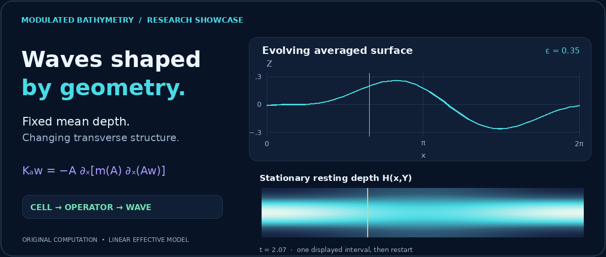
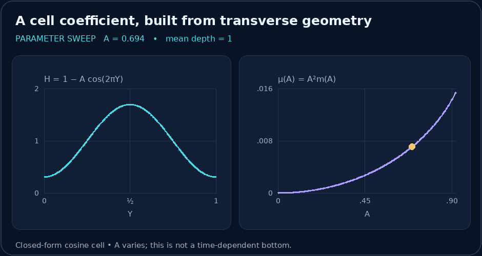
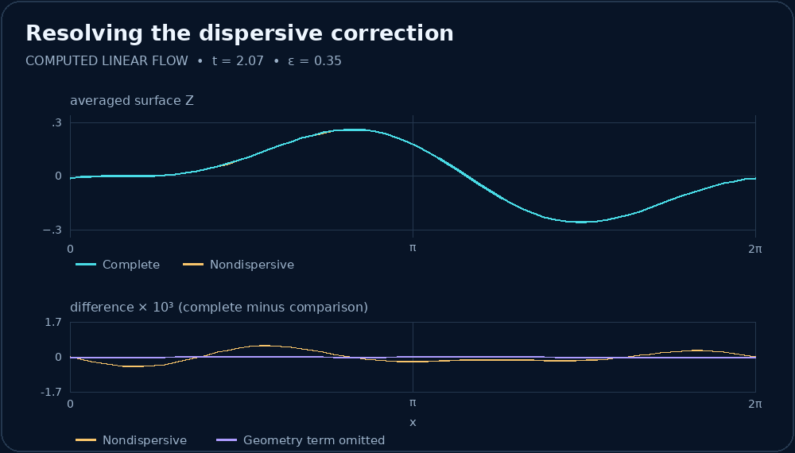
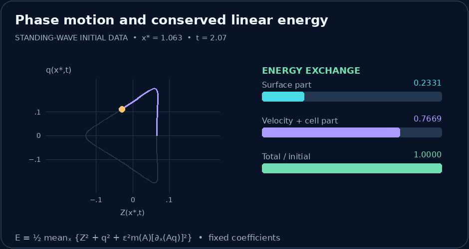
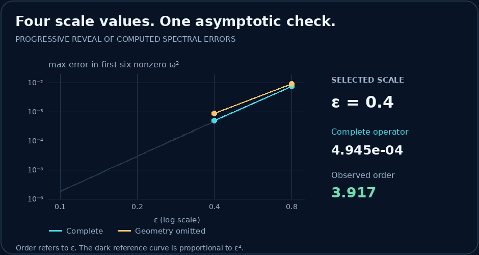

# Static gallery

A motion-free view of the original scientific figures. Each flow poster shows one sampled instant; it is not a time average. [Figure explanations](visualizations.md) · [Mathematics](mathematical_overview.md) · [Results](results.md)

## Research header

## Cell coefficient

## Wave comparison

## Phase and energy

## Spectral comparison

The complete four-value numerical table appears in [Results](results.md).
